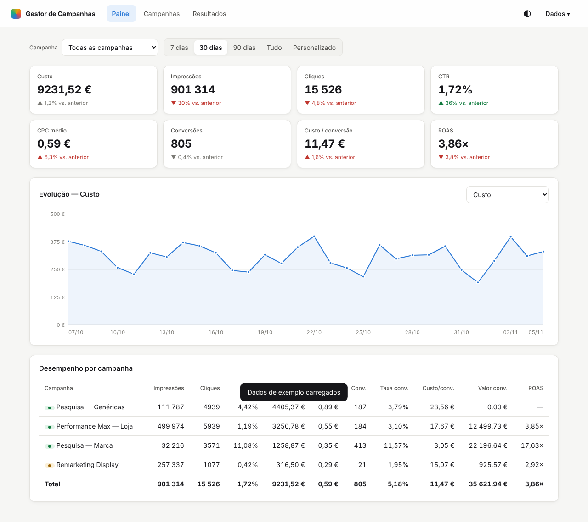

# Gestor de Campanhas Google Ads

Aplicação web simples para registar manualmente e analisar os resultados de campanhas de Google Ads.
Não precisa de instalação, servidor nem dependências: abra o `index.html` no browser.



## Funcionalidades

- **Campanhas**: criar, editar e apagar campanhas (tipo, estado, objetivo, orçamento diário, CPA alvo, notas).
- **Resultados**: registo diário manual de impressões, cliques, custo, conversões e valor de conversão,
  com pré-visualização das métricas calculadas e opção "Guardar e novo" para lançar vários dias seguidos.
- **Painel**: indicadores (Custo, Impressões, Cliques, CTR, CPC, Conversões, Custo/conversão, ROAS) com
  comparação face ao período anterior, gráfico de evolução por métrica e tabela de desempenho por campanha.
- Filtros por campanha e período (7/30/90 dias, tudo ou intervalo personalizado); tabelas ordenáveis.
- Barra de consumo do orçamento diário e indicação se o CPA está dentro do alvo.
- Exportar/importar resultados em **CSV** (separador `;`, compatível com Excel PT) e cópia de segurança em **JSON**.
- Dados de exemplo para experimentar, tema claro/escuro e layout adaptado a telemóvel.

## Métricas calculadas

| Métrica | Fórmula |
|---|---|
| CTR | cliques ÷ impressões |
| CPC médio | custo ÷ cliques |
| Taxa de conversão | conversões ÷ cliques |
| Custo / conversão (CPA) | custo ÷ conversões |
| ROAS | valor de conversão ÷ custo |

## Dados

Os dados ficam guardados no `localStorage` do browser (apenas neste computador/browser).
Use **Dados → Cópia de segurança (JSON)** regularmente para não os perder.

### Formato CSV para importação

```
data;campanha;impressoes;cliques;custo;conversoes;valor_conversao
2026-11-01;Pesquisa — Marca;1200;130;45,20;14;820,50
```

Datas em `AAAA-MM-DD` ou `DD/MM/AAAA`. Campanhas inexistentes são criadas automaticamente;
um registo existente para a mesma campanha e data é substituído.
